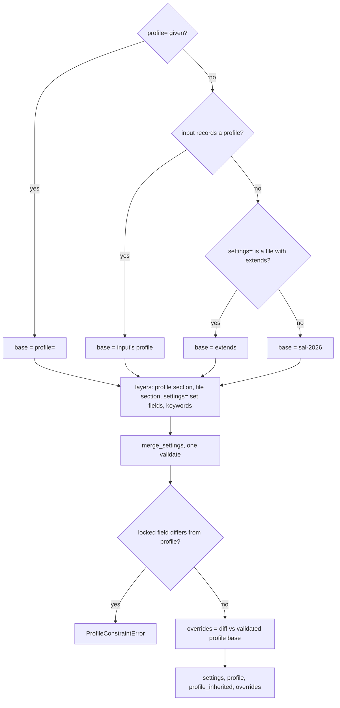

# M1 Slice S3 (Angle Sets, Profiles, Settings, Labels) - Plan

> **For agentic workers:** REQUIRED SUB-SKILL: Use superpowers:subagent-driven-development (recommended) or superpowers:executing-plans to implement this plan unit by unit. Read each spec section a unit cites before starting it. Steps inside a unit use checkbox (`- [ ]`) syntax for tracking.

**Spec:** `design/specs/2026-10-31-phase0-m1-design.md` (draft 0.6), §9 row "S3 Angle sets, profiles, settings, labels", with §6.2.3, §6.3.4, §6.3.6, §6.3.7, §6.3.10, §6.8, §6.9, §6.10, §6.21, §7.1, §7.2, §7.5, §7.6, §11.2, §11.4 and §12. Also `design/plans/2026-10-31-m1-s2-status-quality.md` (its Global Constraints still hold; its "Notes for later slices" S3 items are all placed below) and `design/PRD.md` 1.0 (FR-2.0, FR-2.3, FR-2.4, FR-2.4a, FR-2.9, NFR-10).

**Branch and PR (owner instruction, 2026-11-28).** The build happens on its own branch, `m1-s3-angle-sets-profiles`, created from the tip of `m1-s2-status-quality` (0380a1c at planning; PR #174, itself stacked on `m1-pandas-only`, PR #173) at the start of execution (U1 Step 0). Every unit commits there. After U1's commit the controller pushes the branch and opens a **draft** PR with base `m1-s2-status-quality`, so ci.yml's `pull_request` trigger runs the full matrix on every later push; the PR is retargeted to `soundscapy-rewrite` once #174 merges. Implementers commit and never push; the controller pushes after each unit. U10 makes the branch ready and the controller marks the PR ready for review after the AGENTS.md review sequence (`task check`, `/simplify`, `task check`, `/code-review`).

---

## Goal Capsule

- **Objective:** A user can project any survey under a named, published method and get back which method, angle set and overrides produced every number: the chapter's defaults apply without being asked for, a language without validated angles stops the run or is excluded or flagged in a recorded way, and the eight attributes carry their published labels in the eighteen languages of Aletta et al. (2024).
- **Means:** versioned angle-set and profile files under `_data/`, one settings-resolution function shared by every operation (KTD3), a per-response language resolver inside `project` (KTD5), and translations in the shipped circumplex file (KTD9).
- **Authority:** the spec sections above win on product behaviour; this plan's KTDs win on mechanism within them; the settled decisions in Key Decisions and the labelled KTDs are the owner's and are not re-opened by implementers.
- **Execution profile:** one PR, ten units in dependency order, each unit one commit; test-first for every behaviour (the S1 and S2 way); the controller pushes and the owner reviews.
- **Stop conditions:** a shipped file's content cannot be reproduced from its cited source (U1, U7); the two label transcriptions disagree on a cell (listed for the owner, U7, never silently resolved); a settled decision proves unworkable (report, do not substitute).
- **Finish and ship:** U10, the AGENTS.md review sequence, then the controller's push and ready-for-review.

---

## Product Contract

### Summary

S3 ships the two published angle sets with their confidence tiers, the three analysis profiles as versioned data, settings files that extend a profile, a per-response angle resolver with recorded error, exclude and equal-angles paths, the Aletta 2024 projection formula, translated attribute labels, and two test fixtures (a synthetic indoor circumplex and the Table A.1 scale labels). Every result records its profile, angle sets and overrides.

### Problem Frame

After S2 every projection uses the circumplex's nominal 45° angles and the canonical formula, and nothing in a result says which method it follows. A Spanish or Mandarin survey cannot be projected with its validated angles; a number cannot be produced "under ISO/TS 12913-3:2019" or "as in the 2026 chapter" by naming that source; and the choices a user makes cannot be saved to a file and handed on. The circumplex ships English labels only, so a plot for a Dutch audience shows English words. PRD FR-2.4, FR-2.4a and FR-2.9 make these Musts for M1, and FR-2.0 requires that a second, test-only instrument runs every analysis and plot, which no slice has built yet.

### Key Decisions

- **Plan before build** (session-settled: user-directed — chosen over starting ce-work from the spec row: S3 spans a new module, three data kinds, labels and fixtures). Governs the whole plan.
- **One PR, stacked on #174** (session-settled: user-approved — chosen over two stacked PRs: one careful review of the whole slice, as S1 and S2 had). Governs R27.
- **A passed settings model contributes only the fields the user set** (session-settled: user-approved — chosen over counting every field of the instance: a bare `ProjectionSettings()` must not undo the default profile's `satp@1.5`). Governs R10, R12.
- **`register_angle_set` waits for S4** (session-settled: user-approved — chosen over a validate-and-copy stand-in: it needs the project directory S4 builds). Governs R7, R26.
- **Labels transcribed by two independent agent passes; the owner settles disagreements** (session-settled: user-approved — chosen over the owner checking all 144 cells, or English only in S3: the slice does not block on the owner). Governs R21, R22.
- **The test-only indoor circumplex reaches `read_survey` through a test-only registry override** (session-settled: user-approved — chosen over a public `read_survey(circumplexes=)` keyword: no API beyond the spec, and S4 brings instruments into a project the same way as angle sets). Governs R24.
- **An explicit `profile=` wins over a settings file's `extends`** (session-settled: user-directed — chosen over raising `SettingsError`: keywords beat `settings=` everywhere else). Governs R13.
- **A user angle set passed via `angle_sets=` shadows a shipped set of the same `name@version`** (session-settled: user-directed — chosen over refusing unless identical: provenance records the full user table, so the result stays reproducible from its record). Governs R7.

### Requirements

**Angle sets (§6.8)**

- R1. `AngleSet` is a FrozenModel of the §6.8.1 file: `name`, `version`, `circumplex`, `circumplex_version`, a `[citation]` block and per-language entries with `tier` in `high`, `medium`, `low`, optional `angles_deg` and an optional `note`; a tier-only language has a tier and no angles. Validation is internal only: angles in `[0, 360)` and strictly increasing, a `high` language has angles, every non-empty angle list has the same length, language keys match `^[a-z]{3}$`, `name` is not `"equal"`.
- R2. `AngleSetRef(name, version)` is what settings hold; its label is `name@version`; a string form always carries the version (`"satp@1.5"`, never a bare `"satp"`), and an unknown ref raises `DataReferenceError` listing the shipped labels.
- R3. `aletta-2024@1` ships generated by `scripts/make_aletta_2024.py` from the pinned SATP CSV (commit `3509da3e…`, sha256 `d3ad6da9…`), with the 12 High languages and angles of spec §6.8.2 and the six tier-only languages with the tiers of §6.8.2's table (jpn and kor Medium by the paper's stated rule, their notes citing Table 4's reading); the committed file matches its pin and §6.8.2 offline, and regenerates byte-identically in the nightly `reference` run.
- R4. `satp@1.5` ships written from the chapter notes: 13 High languages with Table 4.8's angles, cmn Medium with the Aletta 2024 angles citing §4.6.1, six Medium tier-only and three Low tier-only languages; a science test parses the notes' two tables and asserts the 23 tiers, the 13 High rows and the cmn equality with `aletta-2024@1`.
- R5. `AngleSelection` holds `default` (`AngleSetRef` or `"equal"`, model default `"equal"`), `per_language`, `on_uncovered` and `on_low_confidence` (each `"error"`, `"exclude"` or `"equal"`, default `"error"`); `per_language` names `AngleSetRef`s only.
- R6. `project` resolves angles per response as §6.8.3's table: `per_language[lang]` else `default`; `"equal"` uses the nominal angles and ignores language; otherwise High projects with the set's label, Medium projects with flag `medium_confidence_language` and one `MediumConfidenceLanguageWarning`, Low follows `on_low_confidence`, and an absent or tier-only language follows `on_uncovered` (`error` raises `UncoveredLanguageError` or `LowConfidenceLanguageError`, `exclude` writes the matching reason, `equal` projects with nominal angles, flag `equal_angles_fallback`, label `equal` and one `EqualAnglesFallbackWarning`). A named set with no mapped language column raises `MappingError`; a blank language on an included row raises `MappingError` naming the rows. Errors and warnings list each language with its count and name the override that applies; a tier-only language's message names its tier.
- R7. Sets resolve from `angle_sets=` first, then the shipped registry; a passed set shadows a shipped one of the same label for that call. A set whose `circumplex`/`circumplex_version` differs from the survey's, or whose angle count differs from the circumplex's positions, raises `DataReferenceError` naming both. A user's angle-set TOML is read with `read_angle_set(path)`.
- R8. Provenance records every set a response used: a shipped set as `{kind: "angle_set", name, version, hash}` with its `_data` pin; a passed set with its full table under `content` and `hash_json` as `hash`. `OriginSegment.angle_sets` holds the sorted distinct labels of included rows; `ssp_angle_set` holds each row's label (`""` for an excluded row).

**Formulation (§6.9.1)**

- R9. `project_scores` and the `Literal` gain `aletta2024`: Aletta et al. 2024's Eqs. 1 to 3 on raw scores with λ = (ρ/2)·Σ|cos θ_i|, accepting any scale and any non-degenerate angle set, emitting nothing; it passes the §7.2 hand values, equals `iso2019` at 45° on 1..5 over all 390,625 responses, and maps a neutral response off the origin whenever Σcos θ_i ≠ 0 (the §7.1 property).

**Profiles and settings (§6.3.4)**

- R10. Each operation's settings resolve by the one precedence rule: base profile section, then a settings file's section, then `settings=` (model or mapping), then explicit keywords; `_UNSET` keywords never override; one `model_validate` runs on the result.
- R11. The base profile is an explicit `profile=`, else the profile recorded in the input's provenance, else a settings file's `extends`, else `sal-2026`; `profile=` takes `"<id>@<version>"` or a bare id meaning the latest shipped version; an unknown profile raises `DataReferenceError` listing `list_profiles()`.
- R12. Three profiles ship as `_data/profiles/<id>/1.toml` with `schema = "soundscapy.profile"`, `schema_version = 1`, `id`, `version`, `locked` (dotted keys), `notes`, a `[citation]` block and one section per operation: `sal-2026@1` (canonical, `satp@1.5`, `item_statistics.dispersion = "iqr"`, nothing locked), `iso-12913-3-2019@1` (`iso2019`, `equal`, `range`, locked `projection.formulation`, `projection.angles.default`, `projection.angles.per_language`, `item_statistics.dispersion`), `iso-12913-3-2024@1` (canonical with the "interpretation pending the owner's check of the text" note, `equal`, `iqr`, the same locks). A resolved locked field that differs from the profile's value raises `ProfileConstraintError` naming the field and suggesting `profile="sal-2026"`; the ISO profiles thereby refuse `aletta2024`.
- R13. A settings file is TOML with a required top-level `extends` and the §6.3.4 section names; `extends` missing, an unknown top-level key, invalid TOML or a missing file raise `SettingsError` (the `extends` message lists the shipped profiles and names `save_settings`); a section for another operation is ignored by this call; when `profile=` and `extends` disagree, `profile=` is the base and the file's sections still apply.
- R14. Every survey-derived result records `provenance["profile"] = {id, version, hash}` and `provenance["overrides"]` (dotted keys whose resolved value differs from the base profile's effective value); `project` left with `profile` unset inherits the survey's profile, and an explicit different profile records the survey's as `provenance["profile_inherited"]` with `overrides` computed against the explicit one. The profile is recorded only here, not in `data_refs`.
- R15. `read_survey`, `datasets.isd.load`, `datasets.course_demo.load` and `project` take `profile=`, and their `settings=` accepts a path; `project`, which has no `settings=` today, gains it (model, mapping or path) together with `on_uncovered`, `on_low_confidence` and `angle_sets=`; every new keyword is keyword-only with an `_UNSET` default and the S2 keyword order is kept.
- R16. `list_profiles()` returns the sorted `id@version` labels; `save_settings(path, *, extends, overrides)` writes `extends` as `id@version` plus the overrides as sections, validating each touched section against the profile (a locked-field override is refused as `project` would refuse it), and overwrites an existing path; both are top-level names.
- R17. Re-running `project(survey, settings=coords.settings)` reproduces xy and `settings_hash`; the recorded settings are the fully resolved model.
- R18. The default run changes: `project(load_isd(subset=True))` projects under `sal-2026@1` with `satp@1.5`, the 69 cmn rows carry `medium_confidence_language`, one `MediumConfidenceLanguageWarning` fires, and `angles="equal"` (the quick-start) stays warning-free.

**Labels and fixtures (§6.2.3, §7.6, §11.4)**

- R19. `iso-12913-outdoor/1.toml` carries a `Translation` for each of the 18 languages of Aletta et al. 2024 Table 4, labels as published in the native script (multi-term labels joined as printed), each with that paper's citation block; the file is re-pinned (nothing is released). `label()` falls back to English for pol, yue, tha, bra and alb, and `Circumplex.languages` lists the reference language and the translated codes.
- R20. The shipped `[scale.labels]` equal the Table A.1 fixture `tests/science/fixtures/iso12913_3_table_a1.csv` (scale labels and direction per part, the 0.x wording until the owner's check).
- R21. The transcription is read from the paper's rendered page by two independent agent passes: the first writes the TOML translations, the second writes `tests/science/fixtures/aletta_2024_table4_labels.csv` without seeing the first; a test compares them cell by cell.
- R22. Any disagreeing cell is listed under Open Questions for the owner; the build does not block on it.
- R23. A synthetic three-tier angle set `synthetic-tiers@1` (languages `qaa` high, `qab` medium, `qac` low with angles, `qad` absent, plus a Low tier-only language) and a small survey fixture exercise every resolver branch under `tests/`; they never ship.
- R24. A synthetic indoor circumplex (a different attribute count, axis ids and labels, a 1..7 scale) lives under `tests/` and runs `read_survey` → `project` → `plot.scatter` through the public path, reaching `read_survey` by a test-only override of the shipped-data registry; it never ships.
- R25. The top-level `__all__` gains `AngleSet`, `AngleSetRef`, `list_profiles` and `save_settings` (28 names).

**Process**

- R26. `register_angle_set`, the project's `angle_sets/` and `settings.toml` (rank 3), and `profile=` on operations that do not exist yet are out of S3.
- R27. The slice lands as one PR per the branch instruction above, with `task check` green on every unit, the AGENTS.md review sequence run on the final change, and the nightly `reference` job green on the PR head.

### Success Criteria

- The §9 S3 done-when holds: the committed aletta and satp files match their pins and sources offline and the aletta file regenerates byte-identically nightly; error, exclude and equal paths pass on the synthetic three-tier set and the mixed-language subset sites; tier-only languages resolve as uncovered naming their tier; the 2019 carry-over test passes; the Medium warning fires once for cmn; `iso2019` is refused on 1..7; `aletta2024` passes its hand values, 45° reduction and neutral-off-origin property and the ISO profiles refuse it; the 18 sourced languages have labels with a citation and the gap languages fall back to English; every model round-trips through TOML with an equal hash.
- `tests/science/test_s3_done.py` is the one command that shows the slice is done.

### Scope Boundaries

- Not built, by the spec's slicing: the project directory, `register_angle_set`, `settings.toml` at rank 3 (S4); profiles on `describe`, `density`, statistics (S5, S6); the CLI (M3); tutorial A's language section and the explanation pages (S10).
- Considered and not built: a warning for `aletta2024` (spec §11.2: choosing it is deliberate); a `per_language` value of `"equal"` (spec types it as refs only; recorded for the owner's non-blocking list); a `describe_profile()` (nothing needs it yet); validating other operations' sections of a settings file against models that do not exist (R13 ignores them).

#### Deferred to Follow-Up Work

- S4: `register_angle_set(project, path)` and the project's `angle_sets/` and `circumplexes/` as the second lookup source; `settings.toml` at rank 3; replace the test-only registry override with project registration where tests allow.
- S5, S6: each new operation's profile section, read through `resolve_settings` (KTD3); `item_statistics.dispersion` is already in the shipped profiles.
- S9: the full-ISD loader takes feature columns from the registry entry, not the sidecar (S2 review note).
- S10: the language section of tutorial A on `satp@1.5` and the synthetic set; the plotting how-to's font note for non-Latin labels.

### Open Questions

- For the owner, after U7: the label cells on which the two transcription passes disagree (none known yet). Non-blocking: the build ships pass 1's reading and the test is pinned to pass 2's file, so a disagreement fails loudly until the owner settles it.
- For the owner, non-blocking: `per_language` cannot name `"equal"` (see Scope Boundaries).

### Sources

- Angle CSV: `https://raw.githubusercontent.com/MitchellAcoustics/SATP-circumplex-validation/3509da3e9191586430582e42f5f86945aa4965c5/outputs/2024-06-13/sem-fit-ipsatized.csv`, sha256 `d3ad6da994013082090c27e4592ae5bcdf267a91e5e5fe2c7eb5804eef25df05` (downloaded and checked on 2026-11-28; the `Equal comm.` rows with CFI ≥ 0.92, GFI ≥ 0.90, SRMR < 0.08 and the PAQ2 > PAQ3 reflection give exactly the 12 languages and angles of §6.8.2).
- Table 2 of the paper (`design/literature/aletta-et-al-2024-applied-acoustics.pdf`, p. 10) has a text layer; Table 4 (p. 12) is an image and is legible at 300 dpi in crops (`pdftoppm -r 300`, available on the build machine).
- Chapter notes: `design/literature/mitchell-et-al-2026-satp-chapter-4-notes.md` (Tables 4.7 and 4.8 as Markdown tables).
- Code the units extend: `src/soundscapy/instrument/angles.py` (S1's one-field `AngleSelection`), `src/soundscapy/projection/project.py` (`_settings`, `_carried_columns`, `_CARRIED`), `src/soundscapy/projection/formulas.py`, `src/soundscapy/_model.py` (`settings_layer`, `merge_settings`), `src/soundscapy/survey/read.py` (`resolve_import_settings`, `_read_survey`), `src/soundscapy/datasets/_bundled.py`, `src/soundscapy/_data/__init__.py` (`PINS`, `read_toml`), `src/soundscapy/instrument/circumplex.py` (`Translation`, `label`, `circumplex()`), `src/soundscapy/provenance.py` (`OPTIONAL_KEYS` already allows `profile`, `profile_inherited`, `overrides`).

---

## Planning Contract

### Key Technical Decisions

- KTD1. **Angle-set models and the file loader live in `instrument/angles.py`; the resolver lives in `projection/`.** `AngleSet`, `AngleSetRef`, `AngleSelection`, `angle_set(name, version)` (shipped, `functools.cache`, the `circumplex()` pattern) and `read_angle_set(path)` are instrument-layer data. Turning a resolution into `Reason`/`Flag` codes needs `survey.status`, which the instrument layer may not import, so the per-response resolver is `projection/_angles.py` (private), called by `project`.
- KTD2. **`AngleSet` validates itself; the resolver validates the match.** Circumplex identity and angle count are checked when a set meets a survey (R7), because a user set for an unshipped instrument cannot load its circumplex at construction (R1).
- KTD3. **One settings-resolution function in a new bottom-layer module `soundscapy/profiles.py`.** It holds `ProfileHeader` (FrozenModel: `schema`, `schema_version`, `id`, `version`, `locked`, `notes`, `citation`), the raw reader over `_data.read_toml` (sections stay raw dicts; each operation validates its own with its own model), `ProfileRef`, `list_profiles`, `read_settings_file`, `save_settings` and `resolve_settings(model, section, *, keywords, settings, profile, inherited)` returning the validated model, the profile record, `profile_inherited` and `overrides`. `_model.merge_settings` stays as it is and receives the profile section as its first layer; `_model` keeps importing nothing but `errors` (its stated convention), which is why resolution is not added there. The module is added to the bottom layer string of the import-linter contract.
- KTD4. **Overrides are a diff of validated dumps.** `overrides` = dotted keys where `model_dump(mode="json")` of the resolved model differs from that of the profile base (the profile section merged onto the model defaults and validated). This makes `settings=coords.settings` (R17) and partial mappings give the same answer without tracking which layer wrote a key. Locked fields are checked on the same two dumps before the result is returned.
- KTD5. **The resolver is a pure function over arrays.** Inputs: the included mask, the language array, the selection, the resolved sets and the circumplex; outputs: an `(n, k)` angle array, the per-row label array, boolean masks per outcome and per-language counts. `project` turns the masks into `with_reason`/`with_flag` on a copy of the survey's status before `label_arrays()`, recomputes `included`, raises after resolution with the full counts, and warns once per category after the `Coordinates` is built, with `stacklevel` at `project`'s caller.
- KTD6. **The model default of `AngleSelection.default` stays `"equal"`.** The profile supplies `satp@1.5` at rank 4 (R10), `ProjectionSettings()` still constructs for the round-trip test, and `Coordinates.settings` records the resolved model, so tests comparing with `ProjectionSettings()` move to comparing with the resolved value.
- KTD7. **Settings files are validated at the top level by a constant of section names.** `SECTIONS = ("import", "projection", "describe", "density", "contours", "item_statistics", "correlate", "compare_groups", "who5", "source_profile")` plus `extends`; a key outside it is a `SettingsError`, a known section of another operation is ignored (R13). The same constant maps dotted override keys to sections in `save_settings`.
- KTD8. **Provenance shapes.** `profile` is `{id, version, hash}` with the file's `_data` pin; angle sets go in `data_refs` per R8; nothing else changes in `envelope`, whose optional keys already allow the three profile keys. Spec §6.3.6's `data_refs` kinds list is amended to drop `profile` (spec defect 4).
- KTD9. **Translations are emitted by the model, not hand-written.** `test_circumplex.py` requires the shipped bytes to equal `to_toml(circumplex())`, so pass 1 builds `Translation` objects, the file is written through `to_toml`, and the pin is updated in the same commit. The TOML form is therefore the model's array-of-tables (`[[translations]]`), not §6.2.3's `[translations.<code>]` sketch (spec defect 3).
- KTD10. **The warning posture of the suite changes before the default flips.** `tests/_helpers.py` gains `medium_warning()` (a `pytest.warns(MediumConfidenceLanguageWarning)` context) and the session fixture `isd_coords` is built inside it; every test that projects the subset with defaults is adapted in the same unit as the flip (U6), so the suite is never red between commits.
- KTD11. **The indoor fixture overrides the registry, not the loader.** A conftest fixture `test_circumplex_registry` writes the indoor TOML into a temporary directory, monkeypatches `_data.PINS` (adding `circumplexes/indoor-test/1.toml` with its real hash) and `_data._resource` to look there for that path, and clears `circumplex.cache_clear()` on entry and exit. `read_survey`, `project` and `plot.scatter` run unchanged (session-settled, see Key Decisions). Under the default profile the fixture raises `DataReferenceError`, because `satp@1.5` names the outdoor circumplex; its tests pass `angles="equal"` or the 2024 profile.
- KTD12. **Reference tests live in `tests/reference/`** (house-style), the first one removes `Taskfile.yml`'s exit-5 tolerance, and nightly.yml's `paths` gain `scripts/**`, `src/soundscapy/_data/**` and `tests/reference/**`.
- KTD13. **Plot tests draw Latin-script labels only.** Non-Latin glyphs make matplotlib warn under the Agg backend with DejaVu Sans, and `filterwarnings = error` would fail the test; `deu`, `nld`, `spa`, `ita` are drawn, and cmn, arb, jpn, kor labels are asserted through `Circumplex.label()` without drawing.
- KTD14. **Tier-only Low languages go through `on_uncovered`.** Every Low language in both shipped sets is tier-only, so `on_low_confidence` applies only to user sets; `UncoveredLanguageError`'s message names the override that applies, and a test pins that `on_low_confidence="exclude"` alone does not change alb's outcome under `satp@1.5`.

### High-Level Technical Design

Settings resolution, one path for every operation (the `[import]` section in `read_survey`, `[projection]` in `project`):



Per-response angle resolution (R6), after the set for the row is chosen:

| Row's language in the chosen set | Angles | Label | Status change | Once per call |
|---|---|---|---|---|
| set is `"equal"` | nominal | `equal` | none | none |
| High | the set's | `name@version` | none | none |
| Medium | the set's | `name@version` | flag `medium_confidence_language` | `MediumConfidenceLanguageWarning` |
| Low, `on_low_confidence="error"` | none | none | raise `LowConfidenceLanguageError` | n/a |
| Low, `exclude` | NaN | `""` | reason `low_confidence_language` | none |
| Low, `equal` | nominal | `equal` | flag `equal_angles_fallback` | `EqualAnglesFallbackWarning` |
| absent or tier-only, `on_uncovered="error"` | none | none | raise `UncoveredLanguageError` (names the tier) | n/a |
| absent or tier-only, `exclude` | NaN | `""` | reason `uncovered_language` | none |
| absent or tier-only, `equal` | nominal | `equal` | flag `equal_angles_fallback` | `EqualAnglesFallbackWarning` |

Rows excluded before projection are never consulted; a blank language on an included row under a named set is a `MappingError` before resolution.

### Output Structure

```
src/soundscapy/
  profiles.py                                  # KTD3 (new, bottom layer)
  instrument/angles.py                         # AngleSet, AngleSetRef, AngleSelection, loaders
  projection/_angles.py                        # the resolver (new, private)
  _data/angle_sets/aletta-2024/1.toml          # generated
  _data/angle_sets/satp/1.5.toml               # hand-written
  _data/profiles/sal-2026/1.toml
  _data/profiles/iso-12913-3-2019/1.toml
  _data/profiles/iso-12913-3-2024/1.toml
scripts/make_aletta_2024.py
tests/
  reference/test_aletta_2024_regenerates.py    # marker reference (nightly)
  science/fixtures/aletta_2024_table4.csv      # the 12 High angle rows (R3)
  science/fixtures/aletta_2024_table4_labels.csv   # pass 2 of the labels (R21)
  science/fixtures/iso12913_3_table_a1.csv     # R20
  fixtures/synthetic_tiers/1.toml, survey.csv, mapping.toml   # R23
  fixtures/indoor/circumplex.toml, survey.csv, mapping.toml   # R24
  science/test_s3_done.py
```

### Implementation constraints

- Every S1 and S2 Global Constraint holds (uv only; `task check` is done; `_UNSET` defaults; numpy docstrings with `References`; `StrictFloat`; explicit tolerances with a source comment; `pytest.warns` for every warning, asserted to fire once; `re.escape` in `match=`; the ty-ignore convention; no reformatting of untouched files; no dependency added).
- Every new FrozenModel gets a non-default instance in `tests/test_toml_round_trip.py` in the unit that creates it: `AngleSet`, `AngleSetRef`, the widened `AngleSelection`, `ProfileHeader`, `ProfileRef`.
- Every shipped file is pinned in `_data.PINS` in the commit that adds or changes it; the re-pinned circumplex file keeps version `1`.
- Docstrings cite sources: `[@aletta2024soundscape]` (added to `docs/references.bib` in U1: Aletta, F., Mitchell, A., Oberman, T., Kang, J. and 52 others (2024), *Applied Acoustics* 224, 110109, doi 10.1016/j.apacoust.2024.110109) for the angle set, the formulation and the translations; `[@mitchell2026translation]` for `satp@1.5` and the canonical formula; `[@iso12913-3-2019]` for the 2019 profile.
- `survey/read.py` is near 950 lines; the profile and settings code does not go there (KTD3), and the S2 review's extraction note stands for S4.

---

## Implementation Units

### U1. Angle-set models, the two shipped sets, the generator and the reference test

- **Goal:** `AngleSet`/`AngleSetRef` exist, `aletta-2024@1` and `satp@1.5` ship pinned and checked against their sources, and the nightly `reference` run regenerates the aletta file.
- **Requirements:** R1, R2, R3, R4; KTD1, KTD12.
- **Dependencies:** none (Step 0 creates the branch).
- **Files:** modify `src/soundscapy/instrument/angles.py`, `src/soundscapy/instrument/__init__.py`, `src/soundscapy/_data/__init__.py`, `Taskfile.yml`, `.github/workflows/nightly.yml`, `docs/references.bib`, `tests/test_toml_round_trip.py`; create `scripts/make_aletta_2024.py`, `src/soundscapy/_data/angle_sets/aletta-2024/1.toml`, `src/soundscapy/_data/angle_sets/satp/1.5.toml`, `tests/instrument/test_angles.py`, `tests/science/test_angle_sets.py`, `tests/science/fixtures/aletta_2024_table4.csv`, `tests/reference/test_aletta_2024_regenerates.py`.
- **Approach:**
  1. Step 0: `git switch m1-s2-status-quality`, confirm clean and equal to `origin/m1-s2-status-quality`, `git switch -c m1-s3-angle-sets-profiles`. The implementer does not push.
  2. `AngleSet` per R1 with a `languages: tuple[tuple[str, LanguageAngles], ...]` pairs field exposed as a dict property and serialised as the `[languages.<code>]` tables (the `_to_pairs`/`_to_table` pattern of `_model`); `LanguageAngles(tier, angles_deg=(), note="")`; `AngleSetRef` with `parse("name@version")` and `label`; `angle_set(name, version)` over `_data` as `circumplex()` does; `read_angle_set(path)` through `from_toml` with `DataReferenceError`/`SettingsError` as the existing loaders raise.
  3. The generator: PEP 723, `--source PATH` or download at the pinned commit, sha256 refusal, the fit rule and reflection of §6.8.2, the Table 2 transcription as constants (CI, CFI, GFI, SRMR for the 18 languages, from the paper's p. 10 text layer) assigning the six tier-only tiers, asserting the 12 passing languages, writing the TOML with tomlkit and the citation block; idempotent.
  4. `satp/1.5.toml` by hand from the notes, citation block naming the chapter and proof pages, notes stating the proof date and the cmn call.
  5. `_data.PINS` rows for both files; the science test (committed files match pins; aletta angles equal `aletta_2024_table4.csv`, a transcription of the paper's Table 4 angle rows; tier-only tiers per §6.8.2; satp tiers and High rows parsed from the notes' Markdown tables; cmn equality).
  6. The reference test downloads the CSV, checks its sha256, runs the generator into a temporary directory and asserts byte equality with the shipped file; `Taskfile.yml` loses the exit-5 tolerance; nightly `paths` per KTD12.
  7. `docs/references.bib` gains `aletta2024soundscape`.
- **Patterns to follow:** `instrument/circumplex.py` (`circumplex()`, `Translation`, pairs fields), `scripts/make_course_demo.py` (header, hash refusal, tomlkit document), `tests/science/test_isd_subset.py` (pin checks), `tests/science/test_fr15_network.py` (markers).
- **Test scenarios:**
  - `AngleSet` accepts a tier-only language and rejects: a High language without angles, angles out of `[0, 360)`, non-increasing angles, two languages with different angle counts, a key `"en"`, `name = "equal"`.
  - `AngleSetRef.parse("satp@1.5")` round-trips to its label; `"satp"` and `"satp@"` raise `DataReferenceError` whose message lists `aletta-2024@1` and `satp@1.5`.
  - `angle_set("aletta-2024", "1")` returns 18 languages, 12 with angles; `angle_set("nope", "1")` raises `DataReferenceError` listing the shipped labels.
  - `read_angle_set` reads a user file written by `to_toml` back to an equal model; a file with a bad tier raises with the field path.
  - Science: every shipped angle row equals the fixture; `satp@1.5` has 13 High, 7 Medium, 3 Low; `cmn` angles equal in both sets; jpn and kor are `medium` tier-only in `aletta-2024@1`, kor's note contains "56".
  - Reference (nightly): regeneration is byte-identical; a tampered CSV is refused by hash.
  - Round-trip: `AngleSet` with one tier-only and one angled language, `AngleSetRef`.
- **Verification:** `task check` green; `task test:reference` runs the one reference test (locally, with network); the two files appear in `PINS` and `tests/test_data.py` passes.

### U2. The `aletta2024` formulation

- **Goal:** `project_scores` computes Aletta et al. 2024's Eqs. 1 to 3 and the `Literal` names three formulations.
- **Requirements:** R9.
- **Dependencies:** none.
- **Files:** modify `src/soundscapy/projection/formulas.py`, `tests/projection/test_formulas.py`, `tests/science/test_projection.py`, `tests/projection/test_project.py` (the `formulation="aletta2024"` refusal becomes acceptance).
- **Approach:** add the branch with λ_P and λ_E from `scale.range`; it shares the degenerate-sum check; the docstring states the neutral offset and cites `[@aletta2024soundscape]`; `project`'s `_settings` message lists three names.
- **Patterns to follow:** the canonical branch and `_iso2019` in `formulas.py`; the hand-value fixture `tests/projection/fixtures/hand_values.csv`.
- **Test scenarios:**
  - The three §7.2 hand values under the eng angles of `aletta-2024@1` at `1e-12` (float64 sums of 8 terms; checked at 30 digits with mpmath for the spec).
  - Equality with `iso2019` at 45° on 1..5 for the two 2019 hand values and exhaustively over 390,625 responses at `atol 1e-12`.
  - Hypothesis: for random non-degenerate angle sets with |Σcos θ_i| > 1e-6 and a neutral response, x ≠ 0 with the sign of Σcos θ_i (the §7.1 property), and likewise y.
  - A 1..7 scale and a non-nominal angle set are accepted; a degenerate set raises `FormulationError` as for the other formulations.
  - `project(survey, formulation="aletta2024")` runs; the unknown-formulation message names all three.
- **Verification:** `task check` green; `tests/science/test_projection.py` covers the new rows of §7.2.

### U3. `AngleSelection` and the per-response resolver

- **Goal:** the full `AngleSelection` and a pure resolver that turns languages and a selection into angles, labels and outcome masks.
- **Requirements:** R5, R6 (the table), R7 (identity and count checks); KTD2, KTD5, KTD14.
- **Dependencies:** U1.
- **Files:** modify `src/soundscapy/instrument/angles.py`, `tests/instrument/test_angles.py`, `tests/test_toml_round_trip.py`; create `src/soundscapy/projection/_angles.py`, `tests/projection/test_angles.py`, `tests/fixtures/synthetic_tiers/1.toml`.
- **Approach:**
  1. `AngleSelection` per R5; `default` accepts a string `"name@version"` in a before-validator (so TOML and keywords read naturally) and serialises as that string.
  2. The resolver (KTD5) takes `languages`, `included`, `selection`, a `sets` mapping from label to `AngleSet` (already looked up by `project`), and the circumplex; it checks each used set's circumplex identity and angle count (R7); returns angles `(n, k)`, labels `(n,)`, masks `medium`, `low_exclude`, `low_equal`, `uncovered_exclude`, `uncovered_equal`, and an outcome record per language (tier or absent, count, tier-only) for messages and warnings.
  3. Error construction stays in `project` (U4); the resolver only reports `error` outcomes with their languages, so it has no `warnings` or `raise` of its own.
  4. The synthetic set `synthetic-tiers@1` per R23 (notes say it is synthetic; circumplex `iso-12913-outdoor@1`).
- **Patterns to follow:** `survey/read.py` `_languages` (`Counter` listings), `errors._shown`/`_plural`.
- **Test scenarios (on the synthetic set, languages `qaa`, `qab`, `qac`, `qad`, `qae` Low tier-only, a blank cell):**
  - `"equal"` default: nominal angles for every included row, label `equal`, no masks set, language never read (a blank language passes).
  - High row: the set's angles and the label `synthetic-tiers@1`; Medium row: same plus the `medium` mask.
  - Each of the 3 × 3 `on_uncovered` × `on_low_confidence` combinations yields the expected masks for `qac`, `qad` and `qae`; `qae` (Low tier-only) follows `on_uncovered`, not `on_low_confidence` (KTD14).
  - `per_language = {qab: aletta-2024@1}` picks that set for `qab` rows only.
  - A set whose `circumplex_version` differs raises `DataReferenceError` naming both; a set with 7 angles against 8 positions raises naming both counts.
  - Excluded rows are never resolved: a blank language on an excluded row passes; on an included row under a named set the resolver reports it for `MappingError`.
  - Round-trip: `AngleSelection(default="satp@1.5", per_language=(("cmn", AngleSetRef("aletta-2024", "1")),), on_uncovered="exclude")`.
- **Verification:** `task check` green with branch coverage of the resolver at 100% (the coverage floor is 95% with branches).

### U4. `project` with named angle sets

- **Goal:** `project` takes `angles` as a ref string, `AngleSetRef` or `AngleSelection`, plus `on_uncovered`, `on_low_confidence` and `angle_sets=`, writes the resolver's outcomes into the status, labels and provenance, raises and warns per R6, and records sets per R8.
- **Requirements:** R6, R7, R8, R15 (the three keywords), R23.
- **Dependencies:** U2, U3.
- **Files:** modify `src/soundscapy/projection/project.py`, `src/soundscapy/errors.py` (messages only; the classes exist), `tests/projection/test_project.py`, `tests/distribution/test_coordinates.py`, `tests/_helpers.py`; create `tests/fixtures/synthetic_tiers/survey.csv` and `mapping.toml`, `tests/projection/test_project_languages.py`.
- **Approach:**
  1. `project` gains the keyword-only `settings` (a `ProjectionSettings` or a mapping here; the path form arrives in U6), placed after `angles` and before `carry` in the §6.9.2 order; `_settings` becomes layer-building for `merge_settings` (profiles arrive in U6; here the layers are keywords over `settings=` over defaults, as `resolve_import_settings` does today).
  2. Look up every label the selection names: `angle_sets=` first (a passed set shadows a shipped one for this call, Key Decisions), then `angle_set(name, version)`; `angle_sets=` given as a bare `AngleSet` or a string raises `TypeError` (the `carry` pattern); duplicate labels inside `angle_sets=` raise `SettingsError`.
  3. Call the resolver on the survey's included rows; apply `with_reason`/`with_flag` to a copy of the survey's status; the `included` used for projection is the updated one; `ssp_angle_set` is the resolver's labels with `""` on excluded rows.
  4. On an `error` outcome raise after resolution with every offending language and count, the tier for tier-only languages, and the override that applies (`on_uncovered=` or `on_low_confidence=`), in the `_shown` form (at most five, then "and N more", by count descending).
  5. `data_refs`: the survey's refs, then one entry per set used (R8 shapes); `OriginSegment.angle_sets` sorted distinct labels of included rows.
  6. Warnings after the `Coordinates` is built, one `warnings.warn` per category with `stacklevel=2`.
- **Patterns to follow:** `_carried_columns` (keyword checks), `_read_survey` (`data_refs` assembly), `tests/projection/test_project.py` structure.
- **Test scenarios:**
  - `angles="synthetic-tiers@1"` on the synthetic survey (default `error`): `UncoveredLanguageError` names `qad` and `qae` with counts, says "qae (Low, no adjusted angles)" and names `on_uncovered`; with `on_uncovered="exclude"` the rows get `uncovered_language`, NaN xy and `""` labels, and `n_valid` drops by their count; with `"equal"` they project with nominal angles, carry `equal_angles_fallback` and one `EqualAnglesFallbackWarning` listing both languages.
  - `on_low_confidence` the same three ways for `qac`; `on_low_confidence="exclude"` alone leaves `qae` raising (KTD14).
  - The Medium row carries `medium_confidence_language` and exactly one `MediumConfidenceLanguageWarning` fires (asserted with `pytest.warns` and a record count of 1), after the call returns a complete `Coordinates`.
  - `per_language` sends `qab` to `aletta-2024@1` (which lacks it) and so follows `on_uncovered` for that row only.
  - A user set passed via `angle_sets=` named `satp@1.5` with different angles is used, its full table and `hash_json` appear in `data_refs`, and the shipped pin is absent.
  - A user set for `circumplex_version = "2"` raises `DataReferenceError`; `angle_sets="…"` (a string) raises `TypeError`.
  - `angles="satp@1.5"` on `hand_survey` (eng) projects with the eng angles; `angles="nope@1"` raises `DataReferenceError`; the S1 tests that pinned "only equal" are rewritten to these.
  - The mixed-language subset sites: `project(isd_survey, angles="satp@1.5")` under `pytest.warns` flags exactly the 69 cmn rows and no other, and `OriginSegment.angle_sets == ("satp@1.5",)`; `angles="aletta-2024@1"` covers all five languages as High (cmn included), so no warning fires and every included row projects.
  - A survey whose mapping has no language with a named set raises `MappingError`; a blank language cell on an included row raises `MappingError` naming the row id.
  - Provenance carries `quality_skipped` and the S2 keys unchanged; `Coordinates.select` after an exclusion keeps the new reasons.
- **Verification:** `task check` green; `tests/plot/test_scatter.py` and `tests/workspace/test_attach.py` still pass unchanged (the label column set is unchanged).

### U5. Profiles, settings files and the shared resolution

- **Goal:** the three profiles ship pinned, and `profiles.resolve_settings` implements R10 to R13 for any operation's model and section, with `list_profiles`, `read_settings_file` and `save_settings`.
- **Requirements:** R10, R11, R12, R13, R16; KTD3, KTD4, KTD7.
- **Dependencies:** U2 (the lock tests pass `formulation="aletta2024"`), U3 (the profile files name `satp@1.5` and the `[projection]` section validates into `ProjectionSettings`).
- **Files:** create `src/soundscapy/profiles.py`, `src/soundscapy/_data/profiles/sal-2026/1.toml`, `src/soundscapy/_data/profiles/iso-12913-3-2019/1.toml`, `src/soundscapy/_data/profiles/iso-12913-3-2024/1.toml`, `tests/test_profiles.py`; modify `src/soundscapy/_data/__init__.py`, `pyproject.toml` (the layer string), `tests/test_toml_round_trip.py`.
- **Approach:**
  1. The profile files per R12, each with a `[citation]` block (2019 and 2024: the standard, no DOI, as the circumplex file does; `sal-2026`: `[@mitchell2026translation]`), `locked` as dotted keys, and `[import]`, `[projection]`, `[item_statistics]` sections; `sal-2026`'s notes say it follows the chapter and uses `satp@1.5`.
  2. `ProfileHeader` validates everything but the sections; `read_profile(ref) -> (header, sections, hash)` over `_data.read_toml` and `_data.pin`; `list_profiles()` from `PINS` keys under `profiles/`; latest version by `packaging`-free comparison of dotted numeric versions (shipped versions are `"1"` today; the rule is documented).
  3. `read_settings_file(path) -> (extends, sections)` per R13 and KTD7 (`SettingsError` for a missing file naming the path, invalid TOML through `parse_toml`, missing `extends`, unknown top-level key).
  4. `resolve_settings` per KTD3, KTD4 and the HTD diagram; `profile=` and a file's `extends` both present and different: `profile=` wins (Key Decisions).
  5. `save_settings(path, *, extends, overrides)` per R16, using `to_toml`-style tomlkit writing, overwriting.
- **Patterns to follow:** `_model.settings_layer`/`merge_settings`/`validate`, `_data.read_toml`, `datasets/_bundled.py` (`data_refs` shapes), `instrument/circumplex.py` (`DataReferenceError` listing labels).
- **Test scenarios (on a toy FrozenModel plus `ProjectionSettings`):**
  - `list_profiles() == ("iso-12913-3-2019@1", "iso-12913-3-2024@1", "sal-2026@1")`; `profile="sal-2026"` resolves to version 1; `profile="x@1"` raises `DataReferenceError` listing them.
  - Rank by rank (§7.1): the profile section beats the model default; a file section beats the profile; `settings=` beats the file; a keyword beats all; `_UNSET` keywords change nothing; the merged result validates once.
  - `overrides` is empty when nothing differs from the profile; `{"projection.angles.default": "equal"}` when a keyword sets it; a `settings=` instance from a previous run under the same profile gives empty overrides (R17's basis).
  - Locked: `profile="iso-12913-3-2019"` with `formulation="canonical"` raises `ProfileConstraintError` naming `projection.formulation` and suggesting `sal-2026`; with `angles="equal"` it passes; `profile="iso-12913-3-2024"` with `formulation="aletta2024"` raises; `sal-2026` with `aletta2024` passes and records the override.
  - Settings file: a file with `extends = "iso-12913-3-2019"` and `[projection] formulation = "iso2019"` resolves under that profile; no `extends` raises `SettingsError` whose message lists the three profiles and names `save_settings`; `[projektion]` raises naming the key; `[describe]` is ignored by `project`'s resolution; a missing path and invalid TOML each raise `SettingsError` naming the path; `extends` disagreeing with `profile=` resolves to `profile=` with the file's sections applied.
  - `save_settings(tmp, extends="sal-2026", overrides={"projection.formulation": "aletta2024"})` writes `extends = "sal-2026@1"` and a `[projection]` table; reading it back resolves to the same model; a locked override under the 2019 profile is refused; an existing file is overwritten.
  - Round-trip: `ProfileHeader`, `ProfileRef`; `tests/test_data.py` sees the three pins; the shipped `[projection]` sections validate into `ProjectionSettings`.
- **Verification:** `task check` green, including `lint-imports` with `profiles` in the bottom layer.

### U6. Profiles and settings files on `read_survey`, the loaders and `project`; the default flips

- **Goal:** every S3 keyword is live on the four public entry points, provenance records the profile, carry-over works, the default projection runs under `sal-2026@1`, and the suite is adapted to the Medium warning.
- **Requirements:** R14, R15, R17, R18, R25; KTD6, KTD8, KTD10.
- **Dependencies:** U4, U5.
- **Files:** modify `src/soundscapy/survey/read.py`, `src/soundscapy/datasets/_bundled.py`, `src/soundscapy/datasets/isd.py`, `src/soundscapy/datasets/course_demo.py`, `src/soundscapy/projection/project.py`, `src/soundscapy/__init__.py`, `tests/conftest.py`, `tests/_helpers.py`, `tests/test_package.py`, `tests/survey/test_read_quality.py` (the "settings file" refusal test), `tests/survey/test_read.py`, `tests/projection/test_project.py`, `tests/datasets/test_isd.py`, `tests/datasets/test_course_demo.py`, `tests/science/test_s2_done.py` and any test that projects the subset with defaults; create `tests/test_settings_precedence.py`.
- **Approach:**
  1. `resolve_import_settings` and `project`'s layer building both call `profiles.resolve_settings` with their section; `read_survey` passes `inherited=None`, `project` passes the survey's `provenance["profile"]`.
  2. `_read_survey` and `project` write `profile`, `overrides` and, when set, `profile_inherited`; `Coordinates.settings` is the resolved model.
  3. The loaders pass `profile` and path `settings` through unchanged; the `settings` type everywhere gains `| str | os.PathLike[str]`; the S2 path-refusal branch goes.
  4. `__all__` per R25; `S3_NAMES` in `tests/test_package.py` (28).
  5. The suite's warning posture (KTD10) lands in this commit together with the flip: `isd_coords` built under `medium_warning()`; the quick-start's `angles="equal"` stays; tests that compared `coords.settings` with `ProjectionSettings()` compare with the resolved model (KTD6).
- **Patterns to follow:** `resolve_import_settings`, `load_bundled`, `tests/survey/test_read_quality.py::test_rerun_with_recorded_settings`.
- **Test scenarios:**
  - Default run (R18): `project(isd_survey)` under `pytest.warns` records `profile == {"id": "sal-2026", "version": "1", "hash": <pin>}`, empty `overrides`, `angle_sets == ("satp@1.5",)`, exactly 69 `medium_confidence_language` flags; `angles="equal"` warns nothing and records `overrides == {"projection.angles.default": "equal"}`.
  - Carry-over (§6.3.4's test): `read_survey(..., profile="iso-12913-3-2019")` then `project(survey)` records the 2019 profile on both, uses `iso2019` and `equal`, and empty `overrides`; `project(survey, profile="sal-2026")` records `sal-2026@1` as `profile`, the 2019 profile as `profile_inherited`, and empty `overrides`.
  - `read_survey(..., settings=path)` with `extends = "iso-12913-3-2019"` records that profile; the same path on `project` applies its `[projection]` section; the file given to `read_survey` only does not reach `project` (the docstring says so).
  - `load_isd(subset=True, profile="iso-12913-3-2024")` and `course_demo.load(settings=path)` pass through; the course dataset (language value `eng`) projects under the default with no warning.
  - `project(survey, settings=coords.settings)` reproduces `xy` and `settings_hash` exactly; `profile` may differ only when the first call passed `profile=` on `project` alone (asserted on numbers, not provenance).
  - A profile-less survey (an S2-era provenance without `profile`, built by hand) falls through to `sal-2026`.
  - `tests/test_package.py`: 28 names, sorted, all resolve; the import stays silent.
- **Verification:** `task check` green with no `pytest.warns` outside the tests that assert a warning; `tests/science/test_s1_done.py` still passes with its explicit `angles="equal"`.

### U7. Translated attribute labels

- **Goal:** the shipped circumplex carries the 18 translations with their citation, checked cell by cell against an independent transcription, with English fallback for the gap languages.
- **Requirements:** R19, R21, R22; KTD9, KTD13.
- **Dependencies:** none (independent of U1 to U6; schedule after U6 so the circumplex re-pin and the data-file work do not interleave).
- **Files:** modify `src/soundscapy/_data/circumplexes/iso-12913-outdoor/1.toml`, `src/soundscapy/_data/__init__.py`, `src/soundscapy/instrument/circumplex.py` (`languages` property, the `label` docstring listing the gap languages), `tests/instrument/test_circumplex.py`, `tests/plot/test_scatter.py`; create `tests/science/fixtures/aletta_2024_table4_labels.csv`, `tests/science/test_labels.py`.
- **Approach:**
  1. Render p. 12 of the paper at 300 dpi (`pdftoppm`) into crops per language block in a scratch directory outside the repository.
  2. Pass 1 (one agent): transcribe the 18 × 8 labels in the native script, multi-term labels joined as printed (`"aangenaam / prettig"`), transliterations in parentheses left out; build `Translation` objects with the paper's citation block; write the file through `to_toml(circumplex())`; re-pin.
  3. Pass 2 (a second agent that has not seen pass 1's output): transcribe the same crops into the CSV fixture (`language,PAQ1,...,PAQ8`).
  4. The test compares every cell; a mismatch is listed under Open Questions for the owner and the pass 1 reading ships until the owner settles it (R22).
  5. `label()` falls back for pol, yue, tha, bra, alb (asserted); `Circumplex.languages`.
- **Patterns to follow:** `test_circumplex.py` (byte equality with `to_toml`), the existing `Translation` validators.
- **Test scenarios:**
  - Each of the 18 languages has eight labels and a non-empty citation; `label("PAQ1", "deu") == "angenehm"`, `label("PAQ8", "nld") == "kalm / rustgevend"`; each gap language returns the English label; `languages` lists `eng` plus the 18 codes.
  - Every cell equals the pass 2 fixture (exact).
  - A translation for `eng` is rejected (existing validator, now exercised against the shipped file).
  - Plot: `plot.scatter(isd_coords, label_language="deu")` draws the German axis labels; `label_language="xyz"` draws English (KTD13: Latin-script languages only in drawing tests).
- **Verification:** `task check` green; the shipped bytes equal `to_toml(circumplex())` and the new pin.

### U8. The Table A.1 fixture and the synthetic indoor circumplex

- **Goal:** the scale labels are checked against a transcribed Table A.1, and a second instrument with a different attribute count, axes and labels runs `read_survey` → `project` → `plot.scatter` through the public path.
- **Requirements:** R20, R24; KTD11.
- **Dependencies:** U6 (the default profile's behaviour on another instrument), U7 (labels API).
- **Files:** create `tests/science/fixtures/iso12913_3_table_a1.csv`, `tests/science/test_table_a1.py`, `tests/fixtures/indoor/circumplex.toml`, `tests/fixtures/indoor/survey.csv`, `tests/fixtures/indoor/mapping.toml`, `tests/instrument/test_indoor_circumplex.py`; modify `tests/conftest.py` (the registry-override fixture), `tests/plot/test_scatter.py`.
- **Approach:**
  1. The Table A.1 CSV: part (2 or 3), scale step 1..5, the 0.x wording, and the direction note; the test compares the shipped `[scale.labels]` with the fixture's Part 2 rows and documents that the wording awaits the owner (the file's own `notes` already says so).
  2. The indoor circumplex: six attributes `PAQ1`..`PAQ6` at 0, 60, …, 300 degrees with invented English labels, axes `Comfort` and `Content`, a 1..7 ordinal scale, quadrants per sign; a 12-row survey and its mapping naming `instrument = "indoor-test"`.
  3. The conftest fixture per KTD11, session-scoped where safe, function-scoped otherwise.
  4. Tests through the public path with `angles="equal"` and with `profile="iso-12913-3-2024"`; a test that the default profile raises `DataReferenceError` naming `satp@1.5`'s circumplex and the survey's.
- **Patterns to follow:** `tests/test_data.py` (the `_raw_bytes` tamper seam), `tests/plot/test_scatter.py` (artist assertions).
- **Test scenarios:**
  - Shipped scale labels equal the fixture's five Part 2 labels in order.
  - `read_survey` on the indoor fixture codes six attributes on 1..7; `project(..., angles="equal")` gives `xy` within the square, labels `ssp_Comfort`/`ssp_Content` in `to_frame()`, and `OriginSegment.effective_scale` 1..7; `formulation="iso2019"` is refused on 1..7 (the done-when row).
  - `plot.scatter` draws six attribute labels and the two axis titles from the indoor file; `label_language` falls back to its reference language.
  - The default profile on the indoor survey raises `DataReferenceError` naming both circumplexes.
  - The override fixture leaves `circumplex("iso-12913-outdoor", "1")` unchanged after the test (cache cleared, PINS restored).
- **Verification:** `task check` green; the indoor fixture is importable by later slices' tests as a plain fixture.

### U9. Done-when test and status

- **Goal:** one test file shows the slice is done, and AGENTS.md records S3.
- **Requirements:** Success Criteria; R27.
- **Dependencies:** U1 to U8.
- **Files:** create `tests/science/test_s3_done.py`; modify `AGENTS.md` (Status).
- **Approach:** the test asserts the §9 S3 done-when items not already pinned elsewhere at one place: the default run's cmn flag count and single warning, the 2019 carry-over, `iso2019` refused on 1..7, the ISO profiles refusing `aletta2024`, the 18 languages with citations and the five fallbacks, and every shipped file matching its pin. AGENTS.md Status: "M1 slice S3 (angle sets, profiles, settings, labels; plan `design/plans/2026-11-28-m1-s3-angle-sets-profiles.md`) is in place; slice S4 is next."
- **Test scenarios:** as listed; each assertion names the done-when row it covers in a comment.
- **Verification:** `uv run pytest tests/science/test_s3_done.py` passes; `task check` green.

### U10. PR-ready finish

- **Goal:** the branch passes the full gate, the floors and the docs build, the review sequence has run on the final change, and the controller can mark the PR ready.
- **Requirements:** R27.
- **Dependencies:** U9.
- **Files:** whatever the review passes change; `docs/_freeze/` if `task docs` changes it.
- **Approach:**
  1. `task check`; the lowest-direct floor run on Python 3.11 in a scratch environment (`git restore uv.lock` after); `task docs` renders offline and the API reference lists `AngleSet`, `AngleSetRef`, `list_profiles`, `save_settings` and the new `profiles` names; commit any `docs/_freeze/` change.
  2. `/simplify` on the branch's change, `task check`, commit `refactor: S3 simplify pass`.
  3. `/code-review` on the same range, address the findings, `task check`, commit `fix: S3 code-review findings`; one more simplify pass on those changes if they are large.
  4. Ready for review: the working tree is clean; the controller pushes, waits for a green ci.yml run and a green Nightly `reference` job on the PR head, and marks the draft ready. The PR body lists the units, the plan calls (the KTDs), the re-pinned circumplex and the five new pins, the done-when evidence (`task check`, `tests/science/test_s3_done.py`), the reference run link, and the label cells, if any, awaiting the owner.
- **Test expectation:** none -- this unit runs the gates and the review passes; it adds code only through their findings.
- **Verification:** both review passes have run on the final changes (AGENTS.md); the Nightly `reference` job is green on the head commit.

---

## Verification Contract

| Gate | Command | Proves |
|---|---|---|
| Full gate, every unit | `task check` | lint, `lint-imports`, ty, the default test run with coverage ≥ 95% branch |
| Reference run | `task test:reference` (network; nightly on the PR) | `aletta-2024/1.toml` regenerates byte-identically (R3) |
| Done-when | `uv run pytest tests/science/test_s3_done.py` | the §9 S3 row |
| Floors | `UV_RESOLUTION=lowest-direct UV_PROJECT_ENVIRONMENT=$SCRATCH/lowest-venv uv run --python 3.11 pytest -p no:cacheprovider`, then `git restore uv.lock` | CI's `lowest` job (U10) |
| Docs | `task docs` | the API reference renders the new names; no `docs/_freeze/` drift unaccounted for (U10) |
| Review | `/simplify`, `/code-review` on `git diff m1-s2-status-quality...HEAD` | AGENTS.md's review sequence (U10) |

Named invariants from spec §7.1 that S3 adds tests for: neutral off the origin (aletta2024), profile carry-over, the settings precedence rank by rank, TOML round-trip of every new model, status invariants after resolver exclusions.

---

## Definition of Done

- Every unit's verification holds and its commit is on `m1-s3-angle-sets-profiles`; no unit is skipped or merged into another without saying so in the PR body.
- The §9 S3 done-when (Success Criteria) is green locally, and the Nightly `reference` job is green on the PR head.
- Every shipped file is pinned; `tests/test_data.py` passes; the circumplex file equals `to_toml(circumplex())`.
- Every new or widened public name has a numpy docstring, cites its source where it implements a procedure, and appears in `__all__` where R25 says.
- Spec amendments this plan calls for are applied to `design/specs/2026-10-31-phase0-m1-design.md`, each marked "Amended at S3 plan review (applied YYYY-MM-DD)": the `data_refs` kinds row (KTD8), the translations TOML form (KTD9), the §6.1 module row for `profiles.py` (KTD3), the `profile=` over `extends` rule and the `angle_sets=` shadowing rule (Key Decisions), tier-only Low languages following `on_uncovered` (KTD14), and `register_angle_set` moving to the S4 row.
- Abandoned attempts are removed from the diff; `uv.lock` is unchanged (no dependency is added).
- Both review passes have run on the final change; the working tree is clean; the controller has pushed.

---

## Appendix

### Spec defects found while planning

1. §9 S3 lists `register_angle_set`, but the project it registers into arrives in S4 (§6.18). Resolved by Key Decisions: it moves to the S4 row.
2. §6.1 names no module for `list_profiles`, `save_settings` and settings resolution; `_model` cannot host them under its own import rule. Resolved by KTD3 (`profiles.py`, bottom layer).
3. §6.2.3 sketches `[translations.<code>]` tables, but S1's `Circumplex.translations` is a tuple whose `to_toml` form is `[[translations]]`, and a test pins the shipped bytes to `to_toml`. Resolved by KTD9.
4. §6.3.6 lists `profile` among `data_refs` kinds and §6.3.4 puts it in `provenance["profile"]`; recording it twice breaks the exact `data_refs` assertions of S1. Resolved by KTD8.
5. §6.3.4 and §11.4 leave open what happens when `profile=` and a file's `extends` disagree, whether `extends` is required, and the order of the three angle-set sources. Resolved by Key Decisions and R13.
6. §6.8.3's "default from the profile" is not a model default. Resolved by KTD6.
7. §7.6's synthetic indoor circumplex has no way into `read_survey` before S4. Resolved by KTD11 (test-only).
8. PRD FR-2.4a's "Low-tier languages are refused by default with an explicit override" reads as `on_low_confidence`, but every shipped Low language is tier-only and follows `on_uncovered`. Resolved by KTD14 (the message steers the user); the PRD wording is left to the owner.

### Notes for later slices

- S4: the project's `angle_sets/` and `circumplexes/` become the second lookup source between `angle_sets=` and the shipped registry; `settings.toml` enters `resolve_settings` as a layer between the file and `settings=`; `register_angle_set` validates with `read_angle_set`.
- S5, S6: `describe`, `density`, the statistics and `who5` call `resolve_settings` with their section; the ISO profiles' `item_statistics.dispersion` lock becomes live in S6.
- S10: tutorial A's language section (the cmn warning, then the synthetic set's three paths); the settings explanation page shows one file passed to each call; the plotting how-to names the font requirement for non-Latin labels.
- The S2 review note on `survey/read.py`'s length: S4's workspace work extracts the age and flag readers or the scale-violation message builder.
